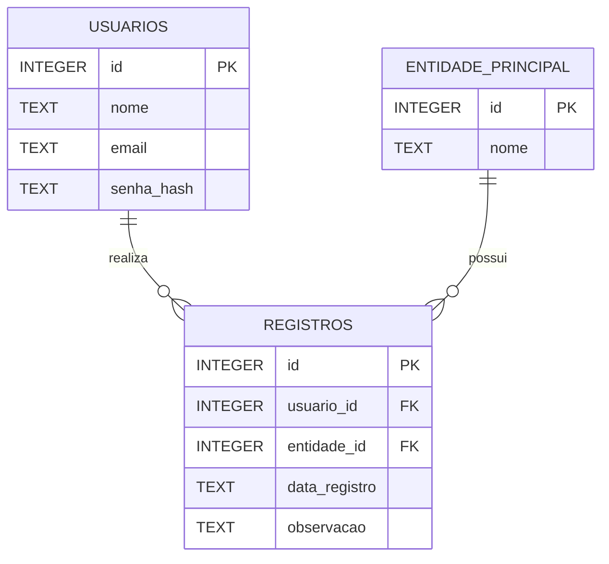

# Entrega 2 — Diagrama Entidade-Relacionamento (DER)

## Como montar

1. Transforme cada grupo de informações persistentes do enunciado em uma entidade.
2. Defina uma chave primária (`id`) para cada entidade, quando adequado.
3. Identifique chaves estrangeiras e cardinalidades.
4. Verifique se relações muitos-para-muitos precisam de uma tabela associativa.
5. Compare o DER com o script SQL: entidades, campos e relacionamentos devem corresponder.

## Modelo Mermaid — substitua pelo tema da prova

Este diagrama é apenas ilustrativo. Ajuste entidades, atributos e cardinalidades ao enunciado e ao banco implementado.
