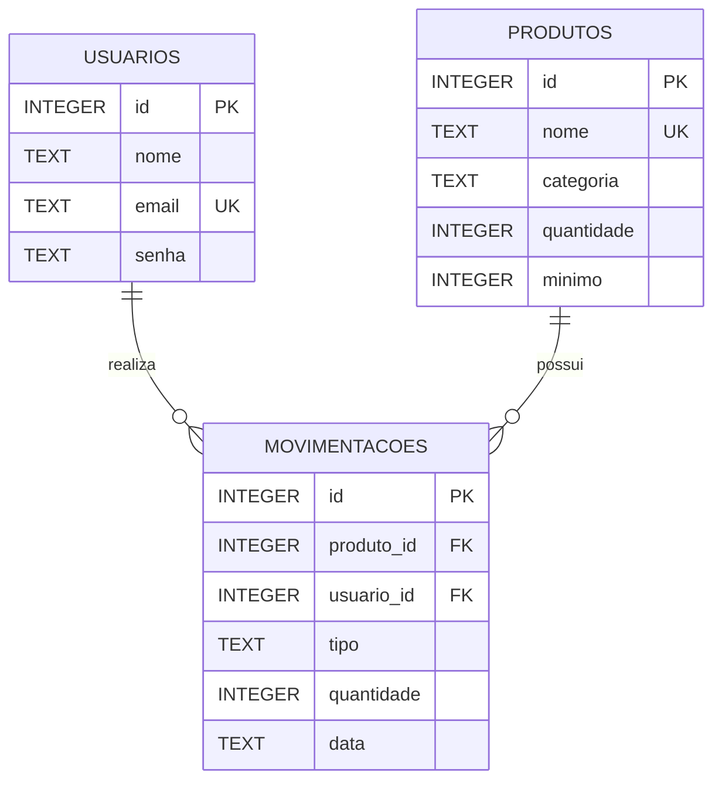
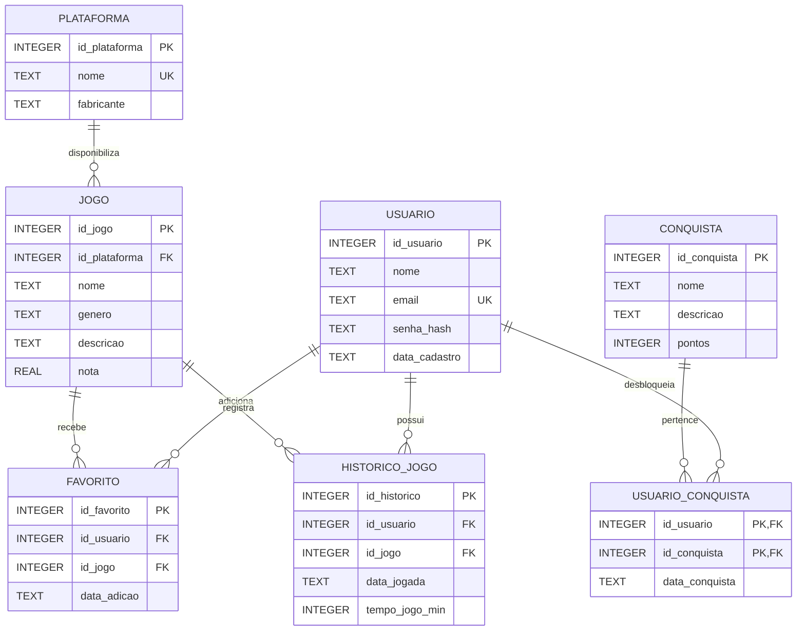

# Entrega 2 — Diagrama de Entidade e Relacionamento (DER)

## Modelo de dados

O banco de dados do sistema é composto por três entidades principais: `usuarios`, `produtos` e `movimentacoes`. A estrutura está alinhada ao script SQL existente no projeto.

## Entidades

### Usuários
Armazena os usuários que podem realizar operações no sistema.

- `id`: chave primária e identificador do usuário.
- `nome`: nome do usuário.
- `email`: e-mail único do usuário.
- `senha`: senha utilizada na autenticação.

### Produtos
Armazena os itens controlados pelo estoque.

- `id`: chave primária do produto.
- `nome`: nome único do produto.
- `categoria`: categoria do produto.
- `quantidade`: quantidade atual disponível.
- `minimo`: quantidade mínima definida para alerta de estoque.

### Movimentações
Registra entradas e saídas de produtos.

- `id`: chave primária da movimentação.
- `produto_id`: referência ao produto movimentado.
- `usuario_id`: referência ao usuário que realizou a operação.
- `tipo`: tipo da movimentação (`entrada` ou `saida`).
- `quantidade`: quantidade movimentada.
- `data`: data e hora da movimentação.

## Relacionamentos

- Um **usuário** pode realizar várias **movimentações**.
- Um **produto** pode possuir várias **movimentações**.
- Cada **movimentação** pertence a um único usuário e a um único produto.

> Observação: as chaves estrangeiras estão explicitamente definidas na inicialização do banco em `src/database/sqlite.js` e a estrutura das três tabelas também está documentada em `schema.sql`.
>
> # Entrega 2 — Diagrama de Entidade e Relacionamento (DER)

## Modelo de dados

O banco de dados do sistema MQLite é composto por sete entidades principais: `Usuario`, `Plataforma`, `Jogo`, `Favorito`, `HistoricoJogo`, `Conquista` e `UsuarioConquista`.

A estrutura foi desenvolvida para organizar os dados dos usuários, jogos, plataformas, favoritos, histórico de jogos e conquistas.

## Entidades

### Usuário
Armazena os dados dos usuários cadastrados no sistema.

- `id_usuario`: chave primária e identificador do usuário.
- `nome`: nome do usuário.
- `email`: e-mail único utilizado no cadastro.
- `senha_hash`: senha armazenada em formato criptografado por hash.
- `data_cadastro`: data de registro do usuário.

### Plataforma
Armazena as plataformas nas quais os jogos estão disponíveis.

- `id_plataforma`: chave primária da plataforma.
- `nome`: nome da plataforma.
- `fabricante`: empresa responsável pela plataforma.

### Jogo
Armazena as informações dos jogos cadastrados no catálogo.

- `id_jogo`: chave primária do jogo.
- `id_plataforma`: chave estrangeira que identifica a plataforma.
- `nome`: nome do jogo.
- `genero`: gênero do jogo.
- `descricao`: descrição do jogo.
- `nota`: avaliação do jogo.

### Favorito
Registra os jogos adicionados à lista de favoritos dos usuários.

- `id_favorito`: chave primária do registro.
- `id_usuario`: referência ao usuário.
- `id_jogo`: referência ao jogo favoritado.
- `data_adicao`: data em que o jogo foi adicionado.

### Histórico de Jogos
Armazena o histórico de jogos dos usuários.

- `id_historico`: chave primária do histórico.
- `id_usuario`: referência ao usuário.
- `id_jogo`: referência ao jogo.
- `data_jogada`: data em que o jogo foi registrado no histórico.
- `tempo_jogo_min`: tempo de jogo em minutos.

### Conquista
Armazena as conquistas disponíveis no sistema.

- `id_conquista`: chave primária da conquista.
- `nome`: nome da conquista.
- `descricao`: descrição da conquista.
- `pontos`: pontuação atribuída à conquista.

### UsuárioConquista
Relaciona os usuários às conquistas que desbloquearam.

- `id_usuario`: chave estrangeira que identifica o usuário e parte da chave primária composta.
- `id_conquista`: chave estrangeira que identifica a conquista e parte da chave primária composta.
- `data_conquista`: data em que a conquista foi desbloqueada.

## Relacionamentos

- Um **usuário** pode adicionar vários jogos aos favoritos.
- Um **jogo** pode ser favoritado por vários usuários.
- Uma **plataforma** pode disponibilizar vários jogos.
- Um **usuário** pode possuir vários registros no histórico de jogos.
- Um **jogo** pode aparecer no histórico de vários usuários.
- Um **usuário** pode desbloquear várias conquistas.
- Uma **conquista** pode ser desbloqueada por vários usuários.
- A tabela `UsuarioConquista` resolve o relacionamento muitos para muitos entre usuários e conquistas.

> **Observação:** as chaves primárias (PK) identificam cada registro de forma única, enquanto as chaves estrangeiras (FK) estabelecem os relacionamentos entre as tabelas. A tabela `UsuarioConquista` utiliza uma chave primária composta por `id_usuario` e `id_conquista`.
