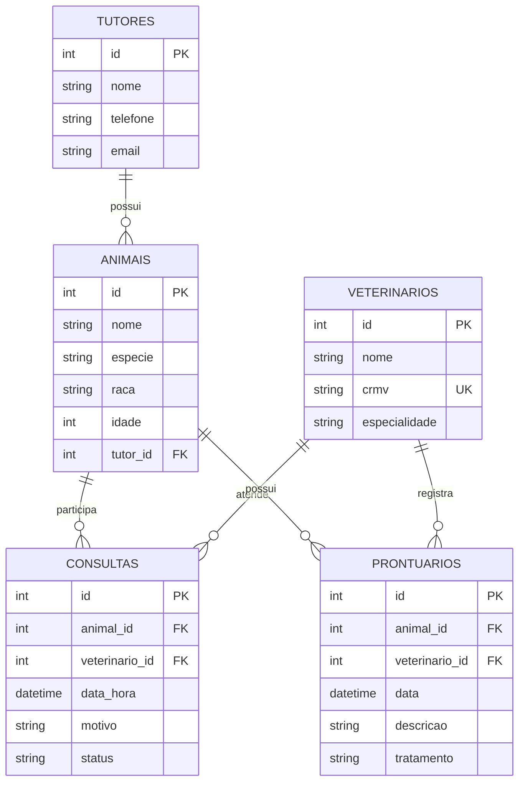

# Clínica Veterinária — Requisitos, regras e banco de dados

## 1. Objetivo

Sistema para organizar tutores, animais, veterinários, consultas e histórico clínico dos animais.

## 2. Requisitos funcionais

- RF01 — Realizar login de demonstração.
- RF02 — Cadastrar, listar, pesquisar, editar e excluir tutores.
- RF03 — Cadastrar, listar, pesquisar, editar e excluir animais.
- RF04 — Vincular cada animal a um tutor.
- RF05 — Cadastrar, listar, editar e excluir veterinários.
- RF06 — Agendar consultas informando animal, veterinário, data/hora e motivo.
- RF07 — Consultar consultas agendadas.
- RF08 — Alterar o status da consulta para Concluída ou Cancelada.
- RF09 — Registrar prontuário com descrição e tratamento.
- RF10 — Consultar o histórico clínico de cada animal.

## 3. Regras de negócio

- RN01 — Tutor deve possuir nome e telefone.
- RN02 — Animal deve possuir nome, espécie e tutor.
- RN03 — A idade do animal não pode ser negativa.
- RN04 — Veterinário deve possuir nome e CRMV.
- RN05 — O CRMV não pode ser repetido.
- RN06 — Consulta deve possuir animal, veterinário, data/hora e motivo.
- RN07 — Um veterinário não pode ter duas consultas com status Agendada no mesmo horário.
- RN08 — Consulta pode ficar Agendada, Concluída ou Cancelada.
- RN09 — Prontuário deve estar associado a um animal e a um veterinário.
- RN10 — Não excluir registros que possuam dependências vinculadas; o banco utiliza chaves estrangeiras.

## 4. Modelo relacional

- usuarios(id PK, nome, email, senha)
- tutores(id PK, nome, telefone, email)
- animais(id PK, nome, especie, raca, idade, tutor_id FK)
- veterinarios(id PK, nome, crmv, especialidade)
- consultas(id PK, animal_id FK, veterinario_id FK, data_hora, motivo, status)
- prontuarios(id PK, animal_id FK, veterinario_id FK, data, descricao, tratamento)

## 5. Diagrama Entidade-Relacionamento

## 6. Testes manuais sugeridos

1. Fazer login com as credenciais de demonstração.
2. Tentar login com senha incorreta.
3. Cadastrar tutor sem telefone e verificar a validação.
4. Cadastrar tutor válido e confirmar na listagem.
5. Editar e excluir tutor sem dependências.
6. Cadastrar animal sem tutor e verificar o bloqueio.
7. Cadastrar animal válido vinculado a um tutor.
8. Pesquisar animal pelo nome ou espécie.
9. Cadastrar veterinário com CRMV.
10. Tentar cadastrar CRMV repetido.
11. Agendar consulta com todos os campos.
12. Tentar agendar outra consulta para o mesmo veterinário no mesmo horário.
13. Concluir uma consulta.
14. Cancelar uma consulta.
15. Registrar prontuário e consultar o histórico do animal.
16. Tentar excluir animal com consulta/prontuário vinculado.

## 7. Observação técnica

O projeto utiliza SQLite com o pacote `sqlite3`. A conexão e criação das tabelas ocorrem em `src/database/sqlite.js`; as rotas ficam em `src/routes/index.js`; a interface chama a API em `public/script.js`. O login fornecido é apenas demonstrativo, com senha em texto simples, e deve ser substituído por autenticação com hash e sessão antes de qualquer uso real.
